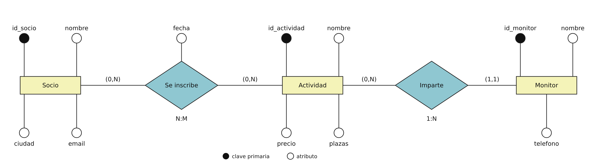

# Práctica de SQL — Gimnasio

Una base de datos pequeña con cuatro tablas para practicar las sentencias básicas de MySQL: **CREATE, ALTER, INSERT, SELECT, UPDATE, DELETE y JOIN**. Hazla en Workbench y guarda tus sentencias en un único fichero `.sql`.

```
monitor (id_monitor, nombre, telefono)
socio (id_socio, nombre, ciudad, email)
actividad (id_actividad, nombre, precio, plazas, id_monitor)
inscripcion (id_inscripcion, id_socio, id_actividad, fecha)
```




- **Socio — Actividad (N:M):** un socio puede apuntarse a 0 o varias actividades, y una actividad puede tener 0 o varios socios. La fecha pertenece a la propia relación. Al pasar al modelo relacional, esta relación se convierte en la tabla `inscripcion`, con las claves de las dos entidades como claves foráneas.
- **Monitor — Actividad (1:N):** una actividad la imparte exactamente un monitor (`(1,1)` junto a Monitor), y un monitor puede impartir 0 o varias actividades (`(0,N)` junto a Actividad). Al pasar al modelo relacional, la clave del lado «1» (`id_monitor`) **pasa a la tabla del lado «N»**, es decir, a `actividad`, como clave foránea.

> **Consejo:** en los `UPDATE` y `DELETE`, filtra siempre por la clave (`WHERE id_socio = 3`). Si filtras por otra columna, Workbench puede dar el error 1175 (modo seguro).

---

## 1. Crear la base de datos

Crea la base de datos `gimnasio` y empieza a usarla.

## 2. Crear las tablas

Crea las tablas con sus PK y FK **en el orden correspondiente**.

| Tabla | Columnas |
|---|---|
| `monitor` | `id_monitor` (entero, autoincremental, clave primaria), `nombre` (texto 50, obligatorio), `telefono` (texto 9) |
| `socio` | `id_socio` (entero, autoincremental, clave primaria), `nombre` (texto 50, obligatorio), `ciudad` (texto 40), `email` (texto 80) |
| `actividad` | `id_actividad` (entero, autoincremental, clave primaria), `nombre` (texto 40, obligatorio), `precio` (decimal 6,2, obligatorio), `plazas` (entero), `id_monitor` (entero, obligatorio) |
| `inscripcion` | `id_inscripcion` (entero, autoincremental, clave primaria), `id_socio` (entero, obligatorio), `id_actividad` (entero, obligatorio), `fecha` (fecha, obligatoria) |

## 3. Modificar la estructura

Sobre la tabla `socio`, por este orden:

1. Añade una columna `telefono` de tipo `VARCHAR(9)`.
2. Cambia el tipo de `telefono` a `VARCHAR(15)`.
3. Elimina la columna `telefono`.

## 4. Insertar datos

Solo vas a insertar **una fila a mano**: tú. El resto de los datos están generados en el fichero `datos_gimnasio.sql`.

1. Inserta tu fila en `socio` con `id_socio` = 1, tu nombre, la ciudad `Malaga` y tu email.
2. Comprueba con un `SELECT * FROM socio` que tu fila está.
3. Abre el fichero `datos_gimnasio.sql` en Workbench (*File → Open SQL Script…*) y ejecútalo entero (rayo). Inserta los monitores, el resto de socios, las actividades y las inscripciones.
4. Comprueba con un `SELECT *` de cada tabla que hay **3 monitores, 6 socios, 4 actividades y 8 inscripciones**.

> Si el fichero da error 1452, es que no has insertado tu socio 1 antes de ejecutarlo. Hay inscripciones que apuntan a él. 

## 5. Consultas sencillas

Escribe una consulta para cada apartado y compara con el resultado esperado:

| | Consulta | Resultado esperado |
|---|---|---|
| 5.1 | Todos los datos de todos los socios | 6 filas |
| 5.2 | Nombre y email de los socios de Málaga | Tú y Carla Gil |
| 5.3 | Nombre y precio de las actividades de menos de 20 €, ordenadas por precio | Yoga (15.00), Pilates (18.50) |
| 5.4 | Nombre de los socios cuyo nombre empieza por «A» | Alberto Vega (y tú, si tu nombre empieza por A) |
| 5.5 | Nombre de los socios que no tienen email | Carla Gil, Alberto Vega |
| 5.6 | Las ciudades de los socios, sin repetir ninguna | Malaga, Sevilla, Granada, Cordoba (4 filas)|
| 5.7 |	Las actividades con precio entre 15 y 20 € (BETWEEN) |	Yoga (15.00), Spinning (20.00), Pilates (18.50) |
| 5.8 | Las actividades que cuesten menos de 20 € y tengan 10 plazas o más | Yoga, Pilates |


## 6. Modificar datos

**Consejo:** en los UPDATE y DELETE, filtra siempre por la clave (WHERE id_socio = 3). Si Workbench te da el error 1175 (modo seguro), desactívalo con SET SQL_SAFE_UPDATES = 0; (solo afecta a esta sesión).

1. Carla Gil (socio 3) se ha mudado a **Córdoba**.
2. Sube un **10 %** el precio de Yoga (actividad 1).
3. Quita una plaza a Boxeo (actividad 4).

Comprueba con un `SELECT` que los cambios se han hecho: Yoga debe costar 16.50 y Boxeo debe tener 7 plazas.

## 7. Consultas con JOIN

| | Consulta | Resultado esperado |
|---|---|---|
| 7.1 | Nombre del socio, nombre de la actividad y fecha de todas las inscripciones | 8 filas |
| 7.2 | Las actividades a las que estás apuntado tú (socio 1) | Yoga, Spinning, Pilates |
| 7.3 | Cuántos inscritos tiene cada actividad | Yoga 2, Spinning 3, Pilates 2, Boxeo 1 |
| 7.4 | Los socios que no están apuntados a ninguna actividad | Alberto Vega |
| 7.5 | El nombre de cada actividad con el nombre de su monitor | Yoga y Pilates → Laura Vidal; Spinning y Boxeo → Pablo Ortega |
| 7.6 | Cuántas actividades imparte cada monitor, **incluidos los que no imparten ninguna** | Laura Vidal 2, Pablo Ortega 2, Marta Rey 0 |


## 8. Borrar datos

1. Borra la inscripción número 8.
2. Intenta borrar al socio 1 (tú). **Debe dar error 1451.** Explica con tus palabras por qué.
3. Borra al socio 6 (Alberto Vega). Debe funcionar. ¿Por qué este sí?
4. Intenta borrar al monitor 1 (Laura Vidal): **error 1451**. Borra al monitor 3 (Marta Rey): funciona. Explica la diferencia.


